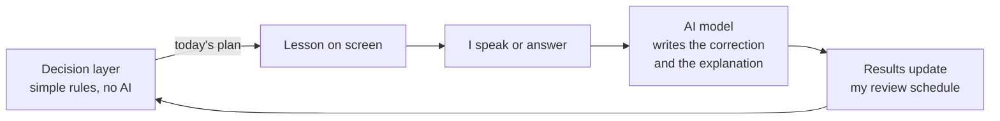
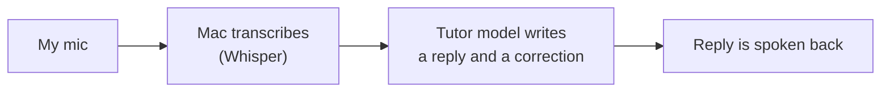

# Mac Rebuild Build Log

This is the plain-language story of where the project is. If you've never heard of it, start here. If you just want the short version: I'm building an Arabic tutor that runs entirely on my own Mac, and I've built the core of the third of five steps.

## Why I Changed Course

The first design had two parts. An Android phone app for talking, and my MacBook sitting at home running one big AI model all day as a server. The phone would call the Mac.

That plan hit three walls.

- **The Mac is a laptop, not a server.** It moves, sleeps, and gets closed. Asking it to be always on was the wrong job for it.
- **The big memory test never passed.** I wanted the AI to hold a huge amount of conversation in its head at once (128K "tokens", which is roughly a very long book's worth of text). During the test it used 39 GiB of memory at peak. My budget is 36 GB. Then it returned an empty reply. Too big, and it didnt even answer.
- **It wasn't really teaching.** It was chat. No lesson order. No schedule for when to see a word again. No pronunciation help written out in English letters, and no English meaning next to the Arabic.

So I changed direction. The new version is **Mac only**, used at my desk, with a native Mac app instead of a phone app. The goal is simple. Speak and understand Arabic, about 30 minutes a day. It also uses newer, lighter AI models instead of the one huge one.

## The New Idea in One Picture

Most of the old design leaned on the AI for everything. That's the problem. AI tutors that run the whole show tend to drift and make things up over a long session.

The fix is to split the job in two.

- A **decision layer** decides what I study next. It's plain, predictable rules. No AI. It uses a schedule that tracks when I'm about to forget a word (that's called spaced repetition, and the specific method is **FSRS**). It also uses a hand-built skill map of lessons, where each lesson unlocks the next.
- The **AI model** only writes things. Corrections and explanations. That's it.

Here's a concrete example. I say "البنت ذهب إلى المدرسة" (the girl went to school), but I used the boy form of the verb. The AI fixes it to "ذهبت" and explains in English that the verb has to match the girl being female. The decision layer then notes that I slipped on this, and brings it back for review at the right time. The AI never decides when.

### The daily 30 minutes

Four parts, in this order.

1. **Review (about 8 minutes).** Words that are due. I hear it, say it, then check myself.
2. **New material (about 10 minutes).** 5 to 8 new words from the next lesson, mostly built from words I already know.
3. **Speaking drills (about 7 minutes).** English to Arabic and back. The AI grades what I say.
4. **Mini conversation (about 5 minutes).** A short chat that stays inside the lesson's words. It only unlocks once I remember at least 80% of them.

### One honest limit

I don't have a native Hijazi speaker to check anything. Hijazi is the Arabic spoken around Mecca and Jeddah. So the AI's Hijazi always stays labeled "unreviewed suggestion", shown as a small second line and never scored. The standard written Arabic (MSA) gets checked with automatic evidence instead. A second AI model agreeing is one. A word analyzer accepting every word is another. A dictionary match is another.

## The Plan, Phase by Phase

Five phases. Each one needs the one before it.

1. **Pick the AI and trim the old code.** Remove the phone stuff, build a test set, and compare models. Everything else depends on which model I use, so this goes first.
2. **Decision layer and lessons.** Build the review schedule (FSRS) and the first 5 lessons. This builds on Phase 1 because it needs the chosen model to write the corrections. It starts text-only, with no voice, so I can test the logic without audio getting in the way.
3. **The Mac app and voice.** The window I actually use, with microphone in and spoken answers out. This builds on Phase 2 because the app just shows what the decision layer already works out.
4. **Pronunciation and lesson prep.** Score how I say sounds and feed that into the schedule. Also let a bigger model prepare example sentences and drills while the Mac is idle. Everything it prepares waits in a review queue until I approve it. This builds on Phase 3 because it needs a working voice loop to score.
5. **Hardening, then Japanese.** Backups, restore tests, and a memory stress test with everything running at once, staying under 36 GB. Japanese comes only after the Arabic loop is stable.

## Phase 1 Log

Phase 1 is done. Here's what got done, in plain terms.

- **Phone code removed.** The Android app and everything that only existed to talk to it is gone.
- **Live audio kept, with a new route.** The old phone connection was the only thing handling live speech. Detecting when I stop talking, partial text while I speak, cutting in mid-reply, and only saving recordings with my consent. I moved that logic to a local connection that stays on the Mac.
- **A fixed correction format.** Every correction now comes back in the same shape. The fixed sentence, what changed in English, a labeled Hijazi version, the pronunciation in English letters, the English meaning, and tags for the kind of mistake. Same shape every time means the app can rely on it.
- **A test set.** 100 real sentences with human-made corrections. 90 have mistakes and 10 are already correct. They come from university essays written by native Arabic speakers (a public research collection called ZAEBUC). I looked for a set of beginner-learner sentences and couldnt find a free one, so this is the closest I got.
- **A scoring script.** It checks whether the AI's fix matches the human fix.
- **The bake-off.** I ran three models through the same test and timed them.

### Bake-off results

| Model | Answers in the right format | Fix matched the human fix (ignoring punctuation) | Time per reply | Memory used |
|---|---|---|---|---|
| **Gemma 4 26B-A4B** | 100% | 49% | 2.4 seconds | 19.6 GiB |
| Qwen3.8-27B | 99% | 42% | 10.2 seconds | 20.9 GiB |
| Falcon-H1-7B | 62% | 4% | 3.9 seconds | 10.6 GiB |

All three ran in 4-bit form, which is a shrunk version that fits in less memory. Gemma also fixed about 86% of the characters that needed changing, against 80% for Qwen and 8% for Falcon.

**Gemma won.** I expected that. Gemma is trained as a broad multilingual model that includes Arabic. Qwen leans toward English, Chinese, and coding. Gemma is now the live tutor. It's also the lesson-prep model for now, since Qwen was about as accurate and 4 times slower.

### What surprised me

- **Over-correction.** I included 10 sentences that were already correct. The models changed them anyway about half the time. Gemma touched 5 of 10, Qwen 6 of 10, and Falcon 9 of 10. An AI that "fixes" right answers teaches you wrong things. This is a real weakness.
- **How the plan guards against it.** Three things keep it from breaking the lessons. First, the tutor is told to make the smallest possible fix and leave correct sentences alone. Second, if a change is only about style rather than a real mistake, the app says "already correct" instead of showing a correction. Third, every corrected word gets checked by an Arabic grammar-analysis tool (CAMeL Tools) before it's shown.
- **The test is a little off.** The essays are mostly spelling mistakes, like the small hamza marks. For someone who speaks instead of types, the speech-to-text step decides those. So these numbers rank the models fairly, but they dont predict how good the teaching will be. On the grammar-only slice (28 sentences), Gemma matched the human fix on 16, Qwen on 9, and Falcon on 1.
- **Two models I wanted couldnt be tested.** Falcon-H1-Arabic isnt public. I've requested access to Jais-2, and it's waiting for the publisher (Inception) to approve it. The Falcon in the table is the general 7B model, not the Arabic one.
- **Prompt caching helps a lot.** With a long, unchanged set of instructions, the first reply took 6.8 seconds and later ones 0.7. So I'll keep those instructions stable.
- **Still open.** I havent rated the English explanations myself yet. Only a beginner can judge whether they're clear.

## Phase 2 Log

Phase 2 is done. This is the part that decides what I study each day, and it uses plain rules instead of AI. Here's what got built.

### Three cards per word

Every word or phrase becomes 3 practice cards.

- **Hear it, give the meaning.**
- **See the meaning, say it.**
- **Read it.**

FSRS (the memory model) schedules each card for right before I'd forget it. A card I keep getting right shows up less and less. A card I miss comes back soon.

### The daily plan

For a 30-minute session, the plan goes in this order.

1. **Reviews first**, capped at about 8 minutes.
2. **5 to 6 new items.**
3. **Drills** on my weakest items across everything I've started.
4. **A short conversation**, but only once I recall at least 80% of the current unit.

Every block says why it's there. If the conversation is missing, the plan tells me I'm not at 80% yet.

### The brakes

Two rules stop me from moving too fast.

- **No new words when too many reviews are due.** The plan says "clearing reviews first" and skips the new stuff for the day.
- **The next unit stays locked** until most of the previous one has been answered right at least twice and is holding for at least a day.

### The first 5 units

60 items, speaking first.

1. Greetings
2. "I am" and "you are"
3. Wanting and having
4. Numbers 1 to 10
5. Ordering at a café

Short dialogues add at most 2 new words each, so nothing feels like a wall. Transliteration (the pronunciation in English letters, like marḥaban, shukran, and wa-ʿalaykumu s-salāmu) is generated automatically from the vowelled Arabic. Nothing is typed by hand.

Hijazi equivalents are in only where I'm confident, like أبغى for "I want" and إيش for "what". They're always labeled unreviewed. The vowel marks are labeled "machine" until a person reviews them.

I also ran every word through the Arabic analysis tool (CAMeL Tools). It recognized all of them. In 10 places its vowel marks disagreed with mine. In the ones I checked, the tool was the one that was wrong. Sugar is سُكَّر, and it said سُكْر. I kept mine, but all of them stay marked "machine" until someone who really knows Arabic signs off.

### Tuning it with a fake learner

I couldnt wait weeks to see if the rules worked, so I built a simulated learner and ran it through the plan day by day. The first two tries were bad.

| Try | What happened |
|---|---|
| Too loose | All 5 units unlocked in 9 days. New words kept piling onto a growing review backlog. |
| Too strict | Only 2 units in 21 days. Sessions were around 18 minutes, so I'd be wasting time. |
| Just right | All 5 units started by about day 15. Sessions near 30 minutes. Reviews never over the cap. |

### Known gaps

- **Days of the week** arent taught yet.
- **Drills dont feed the memory schedule yet.** Right now they only help me practice.
- **The rules are tuned on a fake learner.** Real use will move things around.

### Where it stands

All 138 tests pass. Phase 1 is commit `79bcc21` and Phase 2 is commit `f1085ef`, both on the branch `mac-v2`.

## Phase 3 Log

Phase 3 core is built. The voice tests arent done yet. This is where the project became an app I can actually sit down and use. It's a native Mac app called **Majlis**.

### The five screens

- **Today.** The daily plan with the reason behind every block. A Start button walks me through it.
- **Review.** Each card asks me to hear it, say it, or read it. Then I reveal the Arabic with vowel marks, the pronunciation in English letters (labeled "machine"), the English meaning, and a Hijazi line (labeled "unreviewed"). Space reveals. Keys 1 to 4 grade.
- **Units.** Lessons, grammar notes, and dialogues. Arabic runs right to left with the English underneath.
- **Live session.** Talk to the tutor with push-to-talk or hands-free. There's a live transcript, a level meter, and a big interrupt button. Recording consent is off by default.
- **Settings.** The interface moves through 4 stages: Trailhead, Bridge, Guided Arabic, Immersion. It only advances when I confirm it, and I can always go back.

The look is a dark "listening room". Very Peri marks the live session, and the Arabic is big.

### The voice loop

Letting go of push-to-talk ends my turn right away. Hitting interrupt stops the tutor mid-sentence.

### Fewer fake fixes

Phase 1 found the tutor "fixes" things that arent wrong. So live corrections now have guards.

- The tutor is told to make the smallest fix.
- If the only change is vowel marks or punctuation, it counts as correct.
- If the tutor's own explanation hedges, or a corrected word isnt recognized by the Arabic analysis tool, the correction gets flagged "needs review" instead of shown as fact.

Honest result on the bake-off's over-corrections. Of Gemma's 6, 2 now show as correct and 2 more get flagged. 2 word-swap rewrites still slip through. The stricter prompt should help, but I havent measured that live.

### Drills and weak spots

Drills are graded Got it or Missed, but they stay separate from the memory schedule so practice doesnt confuse it. Misses get logged as weak spots. The mistakes I make are also logged by type, like gender agreement, so later lessons can target them.

### Voices

Speech output is now plug-in. Any local voice model can be swapped in, and every lesson item can be pre-recorded.

I researched Arabic voices and there are good local options now. Two are on my Mac already.

- **Audar TTS.** Arabic-native, covers MSA and Gulf dialects, and can clone a voice from a 5 to 15 second sample.
- **Fish Audio S2 Pro.** Very expressive, and also strong in Japanese.

Others worth testing are Voxtral (Mistral, with an Arabic male voice), Nabra (tiny, MSA only), and NAMAA Saudi TTS (Saudi dialect).

The plan is a blind listening test of 20 lesson sentences, where I just pick what sounds most natural. Voice cloning matters here. If I ever get a short recording from a native Hijazi speaker, the tutor could sound like that speaker.

### Voice test, round 1

This builds on the plug-in voice setup above. Before I listen to anything, every voice reads the same 20 lesson sentences, and I note down speed, memory, and whether a speech recognizer can understand it.

That last one matters because I'm a beginner. I cant tell by ear if a word is slightly off. So Whisper listens to each clip and I count how many letters it gets wrong. It's a pretty lenient check, because Whisper fills in gaps, but it catches the garbled stuff.

| Voice | Time per sentence | Memory | Whisper errors |
|---|---|---|---|
| Apple Majed (what I have now) | 0.8 s | basically none | 1.8% |
| Chatterbox | 4.1 s | 1.8 GB | 3.0% |
| Audar | 6.3 s | 3.0 GB | 1.2% |
| Fish Audio S2 Pro | 51 s | 34 to 37 GB | garbled |

- **Fish is out.** It needs more memory by itself than the whole app is allowed (36 GB), and it mumbled half the sentence.
- **Chatterbox was a freebie.** It was already on my Mac from another project, and it speaks Arabic.
- **Audar looped once.** It got stuck repeating "I want coffee, please" for 41 seconds. Now it has a length limit and one retry, and it hasnt looped since.
- **All three finalists sound like the same man.** Audar and Chatterbox can copy a voice from a short clip, so I gave them a Majed recording. That way I'm judging how natural they sound, not whether I like a deeper voice.
- **The slow part is loading.** Most of those 4 to 6 seconds is the model starting up for every sentence. With the model kept loaded, Audar takes about 1.5 seconds and Chatterbox about 1.7. That's way better. Lesson audio gets recorded ahead of time anyway, so this only matters for live replies.

Next I do the blind listening test, then decide if Voxtral and Nabra are worth the download.

### Still to do in Phase 3

- Record about 50 short clips of my own Arabic, so speech recognition gets tested on my real beginner voice.
- Rate the blind voice test (`var/reports/tts-blind/index.html`).
- Do a first real end-to-end spoken session.

### Where it stands

168 Python tests and 20 Swift tests pass. Phase 3 core is commit `4133a1a` on the branch `mac-v2`. The voice test work isnt committed yet.

## What's Next

- **Finish Phase 3:** record about 50 clips of my own Arabic, run the blind voice test, and do a first real spoken session.
- **Phase 4:** pronunciation scoring and lesson prep.
- **Phase 5:** hardening, then Japanese.

Right now the code lives at `~/Documents/Projects/language-engine` on the branch `mac-v2`. Phases 1, 2, and the Phase 3 core are committed (latest is `4133a1a`).

## Glossary

- **Model:** the AI program that writes the text. Gemma, Qwen, and Falcon are models.
- **Quantized / 4-bit:** a shrunk copy of a model that uses much less memory and loses a little quality.
- **Token:** a chunk of text, roughly a word or part of one. 128K tokens is a very long conversation.
- **Spaced repetition:** reviewing something just before you'd forget it, so each review sticks longer.
- **FSRS:** the specific spaced repetition method I'm using. It estimates how well I know each item and when it's due.
- **Decision layer:** the simple, predictable rules that pick what I study next. No AI.
- **Skill map:** my hand-built chart of lessons, where each one needs earlier ones first.
- **MSA (Modern Standard Arabic):** the formal written Arabic. It's the foundation here.
- **Hijazi:** the spoken Arabic of the Hijaz region, around Mecca and Jeddah. Labeled "unreviewed" here because no native speaker checks it.
- **Bake-off:** running several models on the same test to see which does best.
- **Over-correction:** the AI changing something that was already right.
- **GiB:** a unit of memory. 1 GiB is a bit over a billion bytes.
- **Push-to-talk:** hold a key while I speak, let go when I'm done.
- **Whisper:** the speech-to-text model that turns my voice into written words on the Mac.
- **Latency:** how long a reply takes to arrive.
