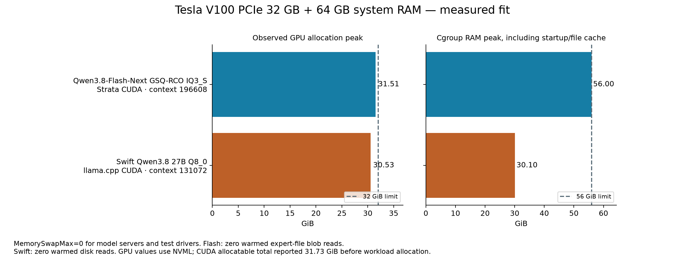
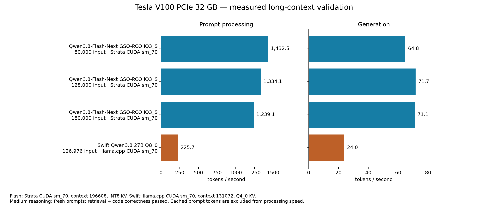
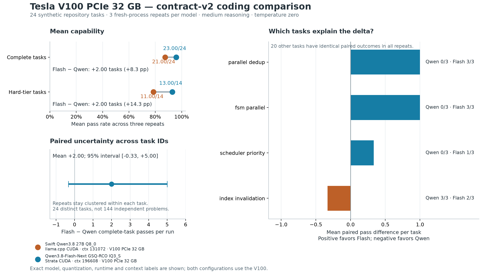
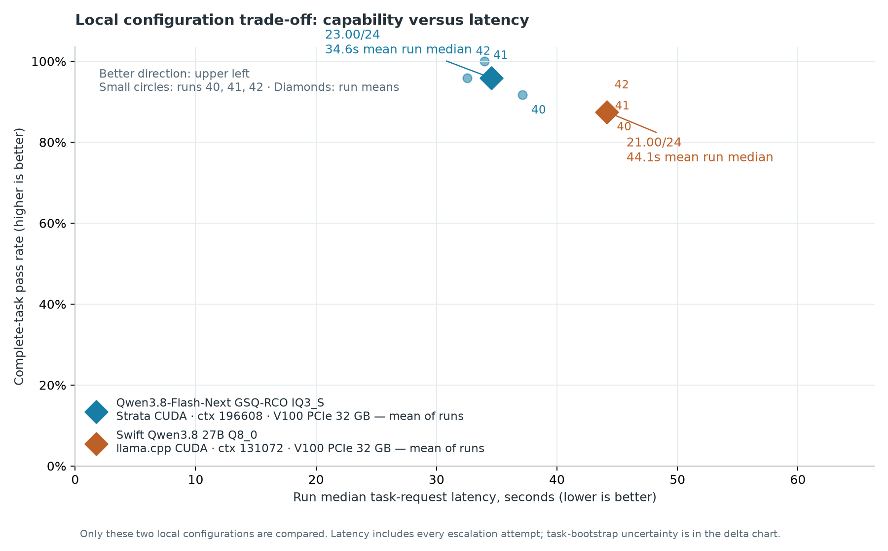

# Strata V100 setup and benchmarks — 2026-10-13

Tesla V100 PCIe 32 GB is working with proprietary NVIDIA 580.178.04. The AMD Raphael iGPU drives the desktop. CUDA allocation/write/readback passed; the new driver initialized during package hooks without a reboot. The default 250 W power limit was retained.

The first passing configurations in the requested candidate order are Qwen3.8-Flash-Next GSQ-RCO IQ3_S and Swift Qwen3.8 27B Q8_0. Context capacity was preserved throughout. Higher precision was selected by compatibility, correctness and memory checks; coding capability was measured separately.

| Model | Runtime | Context capacity | GPU peak GiB | Cgroup RAM peak GiB |
|---|---|---:|---:|---:|
| Qwen3.8-Flash-Next GSQ-RCO IQ3_S | Strata CUDA sm_70 | 196608 | 31.51 | 56.00 |
| Swift Qwen3.8 27B Q8_0 | llama.cpp CUDA sm_70 | 131072 | 30.53 | 30.10 |

RAM peaks include startup and file cache. Flash reached the 56 GiB cgroup limit, with reclaimable startup cache and no workload swap or OOM. Both servers and their benchmark drivers used MemorySwapMax=0. Other desktop processes used swap during initial loading; that is separate from the measured no-swap model workloads.

Atomic IQ4_XS-M64 is a different mixed-quant variant. Its pack converted to native_experts v4 metadata, but Strata rejected its MXFP4 down projection (type 39). This is a tensor-format compatibility rejection, not a measured capacity limit. Q6_K_L and Q6_K were not downloaded because Swift Q8_0 passed.

Flash passed fresh and growing 80K, 128K and 180K input checks, including exact token counts, retrieval, code correctness, prefix reuse and tools. Expert-file blob-read counters stayed at zero after warm-up. Disk-backed PLE reads remained allowed. Swift passed an exact 126976-token input with 4096 output tokens reserved; warmed disk reads were zero. All decoder/output layers were on the V100; approximately 1.3 GiB of Swift input embeddings remained in RAM. Readiness, medium reasoning, final content, streaming and a tool-call round trip passed. These long checks use repetitive reference notes plus retrieval/code tasks; they establish behavior for these fixtures, rather than broad long-context task accuracy.

Twelve applicable core parity checks and native-expert checks on installed model tensors passed. The standalone tensor-core prompt-attention test rejected geometry unsupported on Volta; scalar attention and full-model long-context checks passed.

| Configuration / input | Processed prompt tok/s | Generated tok/s | Complete response s |
|---|---:|---:|---:|
| Flash IQ3_S / fresh 80,000 | 1432.5 | 64.8 | 60.62 |
| Flash IQ3_S / fresh 128,000 | 1334.1 | 71.7 | 100.85 |
| Flash IQ3_S / fresh 180,000 | 1239.1 | 71.1 | 158.63 |
| Flash IQ3_S / growing 80,000 | 1425.9 | 73.6 | 61.29 |
| Flash IQ3_S / growing 128,000 | 1330.7 | 59.6 | 105.03 |
| Flash IQ3_S / growing 180,000 | 1024.4 | 68.5 | 57.43 |
| Swift Q8_0 / fresh 126,976 | 225.7 | 24.0 | 578.56 |

Cached input tokens are excluded from processed prompt speed. Startup, warm-up, raw responses, token counts, temperatures, power and memory samples are retained separately in the evidence directory.

The frozen 24-task contract-v2 coding suite ran three times per model: 144 answers. All were independently regraded in fresh scratch repositories, with complete agreement. Mean complete-task passes: Flash 23.00/24; Swift 21.00/24. The paired task-bootstrap 95% interval for Flash minus Swift is [-0.33, +5.00] passes. All three repeats stay clustered within each of the 24 distinct tasks. Medium reasoning, temperature zero, paired seeds 40–42, frozen budgets/escalations and the previous alternating order were preserved. This comparison measures the recorded local configurations, including their different KV/speculation settings.

The original IQ3_XXS and Q5_K_M V100 references, raw responses and their supplemental API/offload checks remain in the evidence directory. Their reference workloads differ, so they are not presented as a paired capability comparison.

Omarchy hardware/power plugins now show the Raphael iGPU and V100, live V100 VRAM and temperatures, and unavailable readings accurately. CPU idle accounting and hardware history restoration were corrected; iGPU power is counted once when included in CPU package energy. Old plugins and histories are backed up.

Five identified IQ1/IQ2 weight files were removed, freeing 78.8 GiB, including Ornith IQ2_M in both local model locations. Their launcher/provider references were retired; historical results and deletion manifests were preserved. Ornith remains disabled and inactive. The RTX 3060 release was not modified or published.

Builds use CUDA 12.9.1 and signed/extracted GCC 14.3.1 alongside installed CUDA 13. Strata is a separate checkout of d0a44ea7e757c59fa35a78b4b98d0c4bb44ce2cf with the preserved local patch; its build enables STRATA_EXPERIMENTAL_SM60 and architecture 70. Flash uses 12 host threads; Swift uses the runtime default 16. llama.cpp revision is 6c7a87f7e5e5cd75b8a641c3471f2dee84a6ed17. A saved six-declaration CUDA/glibc compatibility patch was applied only to the local CUDA 12.9 toolkit. Swift Q8_0 was downloaded from immutable repository revision 98a6100719e3aafa186041089b71c7b48390dbe1 and verified against its published SHA256.

Evidence and rollback: `~/Work/v100-20261013/`. Build flags, driver/DKMS logs, frozen source hashes, fit results, telemetry, all answers/checkers, independent regrading, extra behavioral probes, profiles, deletion manifests and original configuration backups are retained there. The original Strata checkout and binaries remain available. For a compatible V100 rollback, restore `~/.config/unbiasedstrata/v100-baseline-IQ3_XXS.json` as `config.json` and restart the service. Historical configurations and the backed-up service/launcher remain archived; deleted weights require a fresh download.

Local adoption verified: Strata is running on http://127.0.0.1:8083/v1 with the selected IQ3_S profile and 196608-token capacity. Port 8081 remains occupied by Philosopher. The launcher and OpenCode Strata endpoint now use 8083. A medium-reasoning request returned “V100 ready.” with zero cgroup swap; the engine reported zero expert blob reads. Benchmark servers were stopped. Service boot enablement remains unchanged.

Telemetry over the recorded validation/campaign interval: GPU temperature 32–73 °C; sampled power 23.39–263.59 W, with the 250 W limit retained. Samples include startup and idle periods.

Installed IQ3_S shards have recorded SHA256 hashes; their frozen metadata did not provide a matching published checksum entry, so published verification is not claimed. Swift Q5 and downloaded Q8 both match published SHA256 values.
