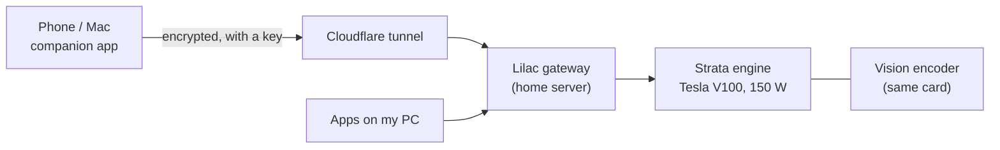
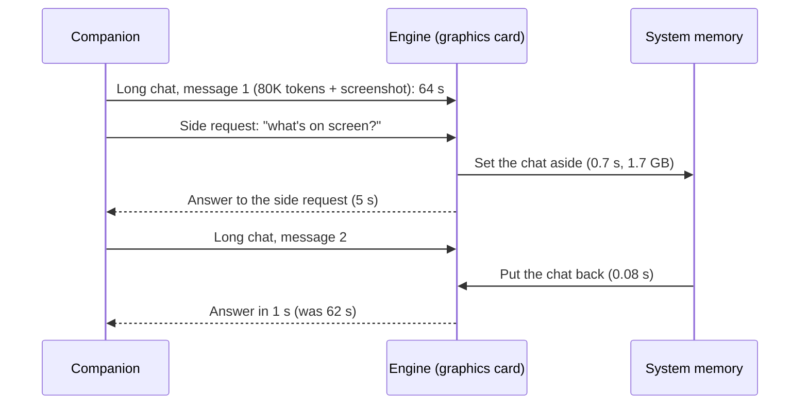

# Strata V100 update — 2026-10-25

**Related:** [[Strata V100 tuning — 2026-10-18]] (the first tuning day) · [[Strata V100 Optimization Showcase]] · [[Strata Bench]] · [[Incident 2026-10-25 — Unraid shares never mounted]] (what happened on the storage server the same day)

## In plain words

I run a large AI model, Qwen3.8 Flash-Next, on my own graphics card at home instead of in the cloud. A small program called **Strata** runs it on an older datacenter card, an NVIDIA Tesla V100. Today's work was about making it a better companion: an assistant on my Mac and phone that can see my screen and keep up with long working sessions. What changed:

- **Long chats no longer stall when something else interrupts them.** Before, any side job between my messages (a quick screenshot check, a title for the chat) pushed the conversation out of the model's working memory, and my next message waited a full minute while it re-read everything. Now the conversation is set aside in system memory and put back in a fraction of a second: **62 seconds → 1 second**, with word-for-word the same answer.
- **The card got a little more power, so it's a little faster.** It now has two power cables, so I raised its limit from 135 W to 150 W. Long documents are read about 7% faster, and the brief power spikes stay at the card's rating.
- **I tested the newest official version of the engine.** It reads long prompts 9% faster, but on 24 real coding tasks it came out even, so I kept my tuned version and set the new one aside, ready.
- **Vision is unchanged and checked.** The model read all seven details correctly from two full-resolution test screenshots, and still answered correctly with both screenshots plus a 180,000-token document at once.
- **A label bug, not a model bug.** My model list said a smaller variant (IQ3_XXS) was loaded. The better one (IQ3_S) was running all along; two labels were out of date. Both are fixed.
- **It's reachable from my phone, safely.** The companion app can reach the model from outside my home through an encrypted tunnel, and only with a key.

### Words used below

| Term | Meaning |
|---|---|
| **Token** | A piece of a word; about ¾ of an English word. "80K tokens" is roughly a 200-page book. |
| **Reading / prefill** | The model working through everything you sent before it can answer. This is the slow part with long documents. |
| **Writing / decode** | The model producing its answer, measured in tokens per second: about 90 here, while reading runs at about 1,400. |
| **Graphics memory (VRAM)** | The card's own 32 GB. Fast, and the scarcest resource. |
| **System memory (RAM)** | The PC's 64 GB. Larger but slower; it holds what doesn't fit on the card. |
| **Experts** | This model is split into many small "expert" pieces and uses only a few for each word. That's how a 78 GB model runs on a 32 GB card: the most-used experts sit on the card, the rest in RAM. |
| **IQ3_S vs IQ3_XXS** | Two compression levels of the same model. IQ3_S is larger and more accurate, and is the one I use. |

### How a message reaches the model

Phone and laptop traffic from outside the house needs a key. The tunnel lets through only the model API, never the dashboard.

## 1. The conversation cache (the big one)

![[strata-v100-update-20261025/conversation-cache.png]]

**The problem.** The model only keeps one conversation in working memory. A companion that watches my screen sends small, separate requests between chat messages, such as "what's on screen now?" or "name this chat". Each one replaced the long conversation, so my next message had to re-read all of it.

**The fix.** Strata has a built-in **conversation cache**, which was switched off. When a different request arrives, it first copies the long conversation's working state into system RAM ("parks" it), then copies it back when that conversation continues.

**Measured** (two rounds each, same questions, on the production setup):

| Step | Cache off | Cache on |
|---|---:|---:|
| First long message (80K tokens + a screenshot) | 63.7 / 64.2 s | 64.0 / 64.2 s |
| Side request with a different screenshot | 4.1 / 4.2 s | 5.0 / 4.8 s *(includes setting the chat aside)* |
| Side request: chat title | 0.4 s | 0.4 s |
| **Next message in the long chat** | **62.0 / 62.1 s** | **1.0 / 1.0 s** |
| Another message right after | 0.5 / 0.9 s | 0.5 s |

- **Quality:** every answer was correct, including a question about the *first* screenshot asked after the interruption. The follow-up answers were identical, character for character, with the cache on and off.
- **Cost:** about 0.7 s extra on the side request that triggers the save, and RAM: **1.7 GB for an 80K-token chat** (about 21 KB per token). It uses **no graphics memory**, so vision gives up nothing.
- **Settings:**
  - Up to 4 GB and three saved chats.
  - Only chats of 8K tokens or more are saved, so tiny side requests can't evict the important one.
  - Saving stops if it would leave less than 5 GB of RAM free.
  - With my desktop open, that's room for one long chat of up to about 100K tokens. A bigger one is simply not saved and gets re-read like before. Nothing fails.

## 2. Where the memory goes

![[strata-v100-update-20261025/memory-map.png]]

The graphics card is full by design: whatever isn't needed for working space is filled with experts, because every expert on the card is one that doesn't have to cross the slower PCIe link. The vision encoder takes 1.2 GB of it. System RAM is dominated by the experts that don't fit on the card.

**Could something be compressed to make room, without losing quality?** I went through the candidates:

| Idea | What it would save | Why not |
|---|---|---|
| Drop the RAM copy of the experts the prompt reader borrows | 14.6 GB of RAM | After every long prompt those experts would be re-read from the SSD instead of RAM, so each long message gets slower. |
| Smaller vision settings (fewer image tokens, more compressed encoder) | up to about 1 GB of VRAM | Already at the best efficient point (8-bit encoder, 2048 tokens per image); less means worse screenshot reading. |
| Smaller model variant (IQ3_XXS) | several GB | Lower answer quality. |
| Smaller safety margin on the card | about 0.2 GB of VRAM | 2.2 GB is the measured floor; 1.6 GB crashed. |
| Fewer saved checkpoints within one chat | 0.35 GB of RAM | Small, and it would slow ordinary follow-ups. |

None was needed in the end: the conversation cache lives in system RAM, and the RAM it needs was already free.

## 3. Power: 135 W → 150 W

![[strata-v100-update-20261025/power-cap.png]]

The card used to run on one power cable, so I kept it at 135 W. Since 2026-10-23 it has two. I compared three limits (two rounds each, an 80K-token prompt plus short ones):

| Limit | Reading 80K (tokens/s) | Whole 80K request | Writing (tokens/s) | Highest spike | Card temperature |
|---|---:|---:|---:|---:|---:|
| 135 W | 1,298 | 64.0 s | 87–92 | 231 W | 58 °C |
| **150 W** | **1,393** | **59.8 s** | 89–92 | 251 W | 60 °C |
| 165 W | 1,464 | 57.2 s | 90–91 | 282 W | 62 °C |

165 W is about 5% faster again, but its spikes go well past the card's 250 W rating, on a PC that had an unexplained power loss the day before. 150 W passed a 13-minute stress test (five back-to-back 180K-token prompts): all answers correct, card at 64 °C, highest spike 259 W. It is now the setting at every boot.

Writing speed doesn't change with power. It's limited by memory speed, not by how much power the card may draw.

## 4. The newest official engine

![[strata-v100-update-20261025/upstream-ab.png]]

The official project released Strata 0.2.6 (engine 0.1.50), which now includes the V100-specific improvements I had added to my own copy. I installed it separately and tested it with the same settings.

- **Out of the box it doesn't fit.** Its default puts 47 GB of experts in plain RAM and nearly runs the PC out of memory at full context length. With my settings it works.
- **Reading long prompts: 9% faster** (80K: 1,395 → 1,526 tokens/s).
- **Real work: even.** On 24 frozen coding tasks it passed one more (24 vs 23), but its median task took 32.2 s against 28.3 s. It writes about 2% slower per token, and its answers came out longer on some tasks and shorter on others.
- **Vision: identical**, 7 of 7 on both.

**Verdict:** a wash for how I use it. My tuned version stays; the new one is installed and ready to swap in.

## 5. Vision check

I made two test screenshots at full 2560×1440 resolution, with known text (a node status table and a code editor with an error bar). Each one uses the full 2048-token image allowance. I then asked seven exact questions: a title, which row is highlighted, every IP address and port, four file names, two constants in the code, a value in a table, and an error message character for character.

| | My engine (in use) | Official 0.1.50 |
|---|---|---|
| Screenshot questions | 7 / 7 | 7 / 7 |
| Worst case: both screenshots + a 180K-token document in one message | correct, 160 s | correct, 149 s |
| Least graphics memory left during that | 906 MB | 782 MB |

The vision encoder is the model's own (not a bolted-on captioner), running on the card at 8-bit precision.

## 6. "Why does my model list say IQ3_XXS?"

The model actually loaded has always been **IQ3_S**: the config points at the IQ3_S files, and the engine log shows it loading them. Two labels were wrong:

1. **My model list** (`fleet.yaml`, which feeds the bar widget and the agent configs) still described the setup from when this ran on an RTX 3060: "IQ3_XXS", "RTX 3060", and an old port. Its status dot was actually checking a different program on that port. It now reads *Local · Strata V100 (IQ3_S)* on the right port.
2. **The engine's own name for itself** is a fixed string in its source code ending in `iq3_xxs`, left over from the original project. It's only a label: requests aren't checked against it, and the gateway calls the model `flash`. Changing it means rebuilding the engine, so it stays for now.

## 7. Reaching it from outside the house

- The companion app talks to the **Lilac gateway** on my home server, which forwards to Strata and keeps track of usage.
- From outside, traffic comes through a **Cloudflare tunnel**: no open ports on my router. Only the model API (`/v1/...`) is let through; the dashboard isn't.
- Requests through the tunnel need an **API key**. Without one the answer is "401 unauthorized"; requests from inside the house don't need one.
- Long answers stream with a small keep-alive signal every 15 seconds. Cloudflare drops a connection that sends nothing for 100 seconds, which a long prompt could otherwise cause.
- I replaced Tailscale (a private network app I didn't use much) with this tunnel.
- The model list the gateway shows was trimmed to models that still exist: `flash` (this model), `mellum` (a small research model), and a planned embedding model on the home server.

## Still open

- **BIOS:** set "Restore on AC power loss" to Power On, so the PC comes back by itself after an outage. Also stability tidying: AI overclocking off, Curve Optimizer −20 → −10/0.
- Optional: rebuild the engine so it calls itself `iq3_s`.
- Merge the gateway's key-check branch into its main branch before the next gateway rebuild.

## Technical details

- **Production:**
  - Engine `unbiased-strata-0.1.43.1-sm70-pr1401`, IQ3_S, context 196,608.
  - INT8 KV with a 32K window on the card, `--resident-experts`, `--adapt-async 1`, `--vram-reserve-mib 2400`, 12 workers.
  - Vision: Q8_0 mmproj at 2048 tokens per image.
  - New: `--conversation-cache-mib 4096 --conversation-cache-slots 3 --conversation-cache-min-tokens 8192 --conversation-cache-min-free-mib 5120`.
  - GPU 150 W (boot drop-in), CPU boost capped at 4.5 GHz.
- **Record:** `docs/V100_TUNING.md` in the fork (branch `v100-pr1401`): round 8 (power), round 9 (upstream 0.2.6 and the adoption gates), round 10 (conversation cache and label).
- **Test scripts:**
  - `local/conv_cache_test.py`, `local/vision_gate.py`, `local/vision_assets.py`.
  - Window scripts in `local/v100/`.
  - Every run goes through the PC's memory and temperature guard, one heavy job at a time.
- **Charts:** `_attachments/strata-v100-update-20261025/`, generated by `local/v100/report/update_20261025.py` from the recorded runs. The memory numbers come from the engine log, `nvidia-smi` and `/proc/meminfo` on the production setup.
