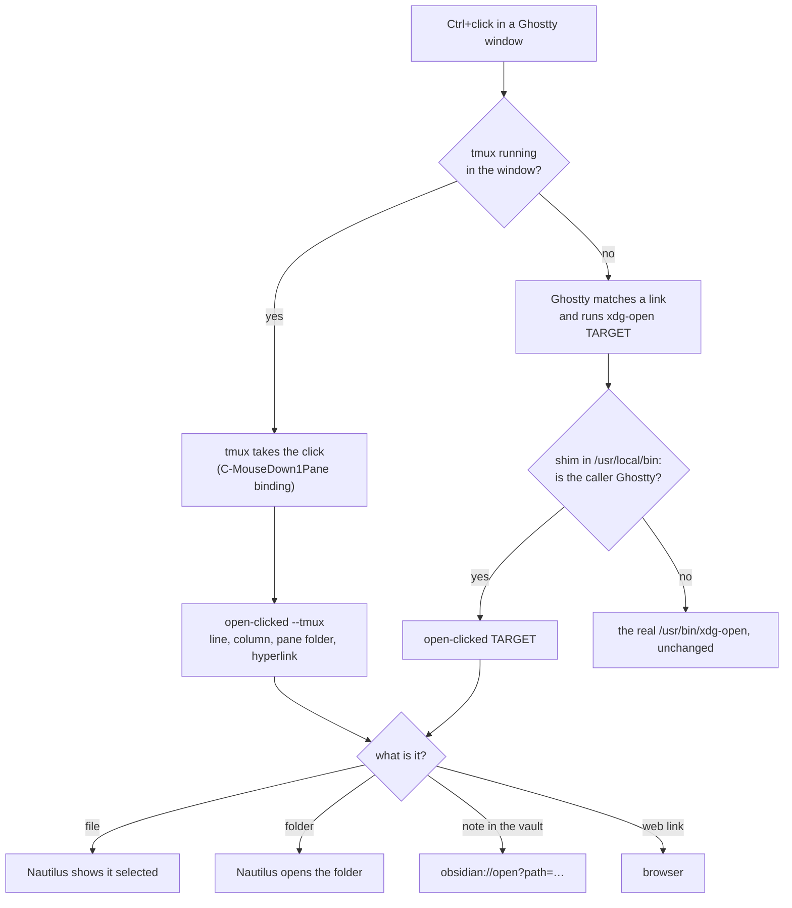

# Clickable File Paths in the Terminal

**Category:** [[Omarchy & Desktop]] · **Vault:** [[Vault Map]] · **Also in:** [[Agents & Tooling]]

## In plain words

AI coding assistants that run in a terminal talk about files all the time: "I saved the screenshot to …", "the notes are in …". Those file names used to be plain text. To get to the file you had to open the file manager yourself and go looking.

Now you **hold Ctrl and click the file name**:

- **A file:** the file manager opens with that file already selected. It doesn't open the file itself, and that's on purpose: from there you can see what's next to it, drag it into a browser or a chat, rename it or delete it.
- **A folder:** it opens in the file manager.
- **A note:** it opens in Obsidian, the notes app these pages are written in. A note here means a Markdown file.
- **A web link:** it opens in the browser.

It works with full file names and with short ones like `notes/today.md`, which means "in the folder the assistant is working in". It also works with names that contain spaces, which assistants print without quotes. Clicking ordinary words does nothing. A name that points nowhere shows a small "No such file" message.

A second fix came with it. The mouse pointer used to vanish whenever a key was pressed, Ctrl included, which is the key you hold to click. It now stays visible.

This is on an Arch Linux desktop (Omarchy, Hyprland) with the Ghostty terminal.

## What a click does

| You click | What happens |
|---|---|
| A file | The file manager (Nautilus) opens with the file selected |
| A folder | The folder opens in the file manager |
| A note in the Obsidian vault (also `.canvas`, `.base`) | Opens in Obsidian |
| Any other Markdown file | The file manager for now; Obsidian once the installed Obsidian package is 1.14 or newer (see Lessons) |
| A web link | Browser |
| `file.py:42` or `file.py:42:7` | The line number is dropped and the file is shown |
| A name that doesn't exist | A "No such file" notification |
| Ordinary text | Nothing |

## How it works

There are two routes, because there are two kinds of terminal window: those running tmux and those without it.



**Inside tmux**, which is where all the long-running assistant sessions live: tmux runs with mouse support on, so it receives every click, and Ghostty's link handling never runs. tmux reports a Ctrl+click as its own key, `C-MouseDown1Pane`. A binding on that key passes the handler script four things: the clicked line, the column, the pane's current folder, and any real hyperlink under the pointer.

The script then finds the path itself. It tries every run of whole words through the click, longest first, and takes the first one that is a real file. That's how it finds `~/Notes/01 Projects/My note.md` without quotes around it. It's also how a short `src/app.py` resolves against the folder the assistant is working in.

**Outside tmux**, Ghostty does its own link matching. On Ctrl+click it runs `xdg-open` with the matched text. A small shim placed ahead of the real `xdg-open` checks which program called it:

- If the caller is Ghostty itself, that's a click, so the shim hands over to the handler.
- Anything else, such as a script or an assistant running `xdg-open` on purpose, gets the real `xdg-open` unchanged.

**The handler** is `~/.local/bin/open-clicked`, written in Python with only the standard library. First it turns the clicked text into a path. It understands:

- `file://` links;
- `~` and `$HOME`;
- `:line:col` suffixes and stray punctuation;
- relative paths.

Then it acts on the result:

- **Files and folders:** it asks the file manager over D-Bus. `org.freedesktop.FileManager1.ShowItems` shows a file and `ShowFolders` opens a folder.
- **Notes:** it opens them with an `obsidian://open?path=…` link, after checking the vault list in Obsidian's own config.
- **Web links:** it hands them to the browser.

**Assistants are told to write full paths.** The global instructions for Claude Code, Codex and opencode ask for paths starting with `/` or `~/`. Those work in every window. Inside tmux, shorter ones work too.

## What went wrong first

The first version only had the Ghostty route, and Ctrl+click did nothing at all. Three things were in the way:

1. **tmux had the click.** With mouse mode on, clicks go to tmux, so Ghostty's link handling never ran and neither did the shim.
2. **tmux already uses Ctrl+click.** By default it means "swap this pane with the marked pane". With no pane marked, it silently did nothing.
3. **The pointer disappeared the moment Ctrl went down.** Omarchy turns on Hyprland's `cursor:hide_on_key_press`, so every Ctrl+click was a click without a visible pointer.

The fix was the tmux route above, plus switching the pointer hiding off.

## The pieces

**The shim**, `/usr/local/bin/xdg-open`. It's owned by root and comes before `/usr/bin` in the terminal's `PATH`:

```sh
#!/bin/sh
# Ghostty opens a Ctrl+clicked link by running `xdg-open TARGET` itself, so
# its own calls have Ghostty as the parent process.  Those go to the user's
# click handler (~/.local/bin/open-clicked), which shows files in the file
# manager and opens Markdown in Obsidian.  Every other caller, including
# anything run from a shell inside Ghostty, gets the real xdg-open untouched.
read -r parent 2>/dev/null < "/proc/$PPID/comm"
if [ "$parent" = ghostty ] && [ -x "$HOME/.local/bin/open-clicked" ]; then
    exec "$HOME/.local/bin/open-clicked" "$@"
fi
exec /usr/bin/xdg-open "$@"
```

**tmux**, in `~/.config/tmux/tmux.conf`:

```
set -as terminal-features ",*:hyperlinks"
bind -n C-MouseDown1Pane select-pane -t = \; run-shell -b -t = '$HOME/.local/bin/open-clicked --tmux --x=#{mouse_x} --line=#{q:mouse_line} --cwd=#{q:pane_current_path} --link=#{q:mouse_hyperlink}'
```

The first line lets real hyperlinks through tmux, such as those from `ls --hyperlink`, `eza` and some assistants. It takes effect when a terminal reattaches to its session.

**Hyprland**, in `~/.config/hypr/looknfeel.lua`:

```lua
hl.config({
  cursor = {
    hide_on_key_press = false,
  },
})
```

**The assistant instruction**, in the global `CLAUDE.md` / `AGENTS.md`:

> File paths: write every file or folder you mention to the user as a full path starting with `/` or `~/` (e.g. `~/Work/clop-linux/README.md:12`). Those are Ctrl+clickable in every terminal window (with or without tmux); a click shows the file in the file manager and opens Markdown in Obsidian.

## Lessons

- **Ghostty 1.3.1 can't be given custom link patterns.** Its `link` option is documented with "TODO: This can't currently be set!". The built-in matcher only treats text as a path when it starts with `/`, `~/`, `./`, `../` or `$VAR/`, so a bare `src/app.py` is never a link there.
- **Ghostty opens links by running `xdg-open` from its own process**, and its documentation says the `env` setting doesn't apply to that call. Checking the parent process (`/proc/$PPID/comm`) is what tells a click apart from everything else. It needs no `PATH` changes and no restart.
- **tmux mouse bindings get the click's context.** `#{mouse_line}`, `#{mouse_x}`, `#{mouse_hyperlink}` and `#{pane_current_path}` are all available, and `#{q:…}` escapes them for the shell. A test string full of quotes, `$`, backticks and `;` arrived unchanged.
- **A pane's folder isn't the terminal's folder.** Under tmux the shell is a child of the tmux server, so the terminal window's own working directory says nothing about where the assistant is working. tmux's `pane_current_path` does.
- **Obsidian updates itself, but some features need a new installer.** The app here was already at 1.14.5 while the system package was still 1.13.7. Opening Markdown from outside a vault is new in 1.14 and needs the 1.14 package. The handler checks the package version, so it switches over by itself after the next system update.
- **Wide characters shift columns.** tmux reports the click as a screen column, and CJK text and some emoji take two columns each. The handler counts display width, not characters.

## How it was checked

- **Path handling, 20 cases:**
  - URLs, and `file://` links with escaped spaces
  - `:line:col` suffixes and stray punctuation
  - relative paths
  - vault notes, and a vault's settings folder
  - missing files
- **Finding the path at a click position, 16 cases:**
  - assistant output with relative paths
  - vault paths with spaces, clicked at either end
  - Markdown links, quoted paths, and `key=/path`
  - wide characters before the path
  - real hyperlinks
  - plain prose, empty space, and clicks past the end of a line
- **The shim** was tested with a fake parent named `ghostty`, from a shell, and with odd file names.
- **Speed:** a click takes about 27 ms. The worst case, a 555-character line with no path in it, adds 1 ms.
- **By hand:** real Ctrl+clicks were confirmed working on 2026-10-26.

## Undo

- **Pointer:** delete the `cursor` block in `~/.config/hypr/looknfeel.lua`.
- **tmux route:** delete the `C-MouseDown1Pane` lines in `~/.config/tmux/tmux.conf`.
- **Ghostty route:** `sudo rm /usr/local/bin/xdg-open`.

## Related

- [[Clop for Linux]] handles the other half of handing files over: `clop drag FILE` turns a file into a card you can drag into a browser or chat.
- [[Desktop Session Persistence]] explains why every assistant terminal runs inside tmux.
- [[Omarchy & Desktop]] · [[Agents & Tooling]]
